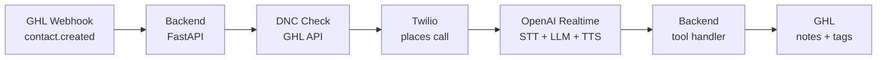

# Architecture

## Flow

**1. GHL sends a webhook** (`ghl_twilio_openai_assistant.py:33`)

A `contact.created` event arrives at `POST /ghl/contact`. Non-creation events and contacts missing name, phone, or practice are dropped.

**2. DNC check** (`ghl_twilio_openai_assistant.py:80`)

The backend fetches the contact from GHL and checks the `dnd` flag and `ai-opted-out` tag. If either is set, the call is skipped and a note is logged.

**3. Twilio places the call** (`ghl_twilio_openai_assistant.py:52`)

Twilio dials the contact. When they answer, Twilio opens a WebSocket stream (`wss://<domain>/media-stream`) carrying the call audio.

**4. Audio relayed to OpenAI Realtime** (`ghl_twilio_openai_assistant.py:111`)

The backend relays audio between Twilio and OpenAI in both directions. OpenAI handles STT, conversation, and TTS as a single streaming session. Server VAD detects when the caller stops speaking.

**5. AI tools update GHL** (`ghl_twilio_openai_assistant.py:383`)

When the AI calls a tool — qualify, book, escalate, or opt out — the backend executes it and writes the result back to GHL as contact notes and tags.

**6. Call ends**

The AI calls `end_call` after booking, escalation, opt-out, or when the conversation is complete. WebSocket connections close.

## Tech stack

| Layer | Technology |
|---|---|
| Webhook + backend | Python FastAPI |
| Voice | Twilio Programmable Voice (bidirectional WebSocket stream) |
| STT + LLM + TTS | OpenAI Realtime API (single session, PCMU audio) |
| CRM | GoHighLevel (contacts, notes, tags) |
