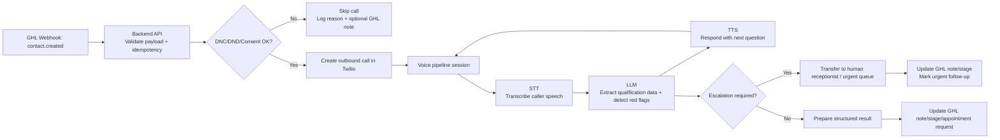

# AI Voice Assistant for Dental Lead Qualification

## Summary
This design implements a small, production-minded workflow for handling new dental leads from GoHighLevel (GHL), calling them through Twilio, qualifying them with an AI voice pipeline, and writing the result back to GHL.

The goal is to automate first-contact lead qualification while keeping clear safety boundaries:
- do not call leads who have opted out
- collect only the minimum data needed for scheduling
- escalate urgent or risky cases to a human immediately
- avoid clinical advice from the AI assistant

## Architecture


## End-to-End Flow
1. GHL sends a `contact.created` webhook to the backend.
2. The backend validates the payload, deduplicates the event, and checks consent, DNC, and DND flags.
3. If the lead is callable, the backend starts an outbound Twilio call.
4. During the call, the AI pipeline transcribes the response, asks the next question, and extracts structured qualification data.
5. If the transcript indicates a red-flag condition, the system stops routine qualification and escalates to a human.
6. The backend writes a summary note and lead status back to GHL. If appropriate, it also stores a requested appointment slot.

## Assumed Interfaces

### GHL webhook input
Illustrative payload shape:

```json
{
  "event": "contact.created",
  "contact": {
    "id": "CNT_xxx",
    "firstName": "Sarah",
    "phone": "+14165551234",
    "email": "sarah@example.com",
    "dnd": false,
    "dnc": false,
    "consentToCall": true
  }
}
```

### AI extraction output
The backend expects the AI layer to normalize the conversation into a structured object:

```json
{
  "pain_level": "7/10",
  "insurance": "Sun Life",
  "preferred_slot": "2025-09-07 15:30",
  "escalation_required": false,
  "summary_note": "Lead reports moderate tooth pain and wants an afternoon appointment."
}
```

### Backend actions
- `handleLeadWebhook(payload)`
- `makeOutboundCall(contact, callContext)`
- `extractLeadQualification(transcript)`
- `updateGhlContact(contactId, qualificationResult)`

## Code Snippets

### 1. Handle the GHL webhook
This example validates the incoming event, checks whether the lead can be called, and initiates the outbound workflow.

```js
import express from "express";

const app = express();
app.use(express.json());

function isCallable(contact) {
  return !!contact?.phone &&
    contact?.dnd !== true &&
    contact?.dnc !== true &&
    contact?.consentToCall === true;
}

async function hasProcessedEvent(eventId) {
  // Replace with Redis/Postgres-backed idempotency store.
  return false;
}

app.post("/webhooks/ghl/contact-created", async (req, res) => {
  const payload = req.body;
  const { event, contact, eventId } = payload ?? {};

  if (event !== "contact.created" || !contact?.id || !contact?.phone) {
    return res.status(400).json({ error: "Invalid webhook payload" });
  }

  if (await hasProcessedEvent(eventId ?? contact.id)) {
    return res.status(202).json({ ok: true, skipped: "duplicate_event" });
  }

  if (!isCallable(contact)) {
    console.info("Lead skipped due to DNC/DND/consent gating", {
      contactId: contact.id
    });

    await updateGhlContact(contact.id, {
      summary_note: "Lead not called because contact is not callable.",
      escalation_required: false,
      status: "do_not_call"
    });

    return res.status(202).json({ ok: true, skipped: "not_callable" });
  }

  const callSid = await makeOutboundCall(contact, {
    leadSource: "ghl",
    contactId: contact.id
  });

  return res.status(202).json({ ok: true, callSid });
});
```

### 2. Initiate a Twilio outbound call
The backend starts the call and points Twilio to a voice webhook that drives the conversation.

```js
import twilio from "twilio";

const client = twilio(
  process.env.TWILIO_ACCOUNT_SID,
  process.env.TWILIO_AUTH_TOKEN
);

async function makeOutboundCall(contact, callContext) {
  const statusCallbackUrl = `${process.env.PUBLIC_BASE_URL}/twilio/status`;
  const voiceWebhookUrl =
    `${process.env.PUBLIC_BASE_URL}/twilio/voice?contactId=${contact.id}`;

  const call = await client.calls.create({
    to: contact.phone,
    from: process.env.TWILIO_NUMBER,
    url: voiceWebhookUrl,
    statusCallback: statusCallbackUrl,
    machineDetection: "DetectMessageEnd",
    asyncAmd: true
  });

  console.info("Outbound call initiated", {
    callSid: call.sid,
    contactId: contact.id,
    callContext
  });

  return call.sid;
}
```

### 3. LLM prompt design for structured qualification
The LLM should behave like a constrained extractor and never improvise medical guidance.

```js
const QUALIFICATION_PROMPT = `
You are a dental office voice assistant helping with lead qualification.

Goals:
1. Collect only the minimum information needed for scheduling:
   - chief complaint in plain language
   - pain level from 0 to 10
   - insurance provider
   - preferred appointment slot
2. Do not provide diagnosis or clinical advice.
3. If the caller mentions severe pain (8-10), swelling with fever, trauma,
   uncontrolled bleeding, allergic reaction, or other urgent symptoms,
   set escalation_required=true immediately.

Return valid JSON only:
{
  "pain_level": "string",
  "insurance": "string",
  "preferred_slot": "string",
  "escalation_required": true,
  "summary_note": "string"
}
`;

async function extractLeadQualification(transcript) {
  const completion = await llm.responses.create({
    model: "gpt-5.4",
    input: [
      { role: "system", content: QUALIFICATION_PROMPT },
      { role: "user", content: transcript }
    ],
    response_format: { type: "json_object" }
  });

  return JSON.parse(completion.output_text);
}
```

Example expected result:

```json
{
  "pain_level": "7/10",
  "insurance": "Sun Life",
  "preferred_slot": "2025-09-07 15:30",
  "escalation_required": false,
  "summary_note": "Lead reports tooth pain for two days, has Sun Life insurance, and prefers an afternoon appointment next week."
}
```

### 4. Write results back to GHL
The exact GHL endpoint can vary by account configuration, so this example is intentionally illustrative rather than claiming a final production endpoint.

```js
async function updateGhlContact(contactId, qualificationResult) {
  const noteBody = [
    `Pain level: ${qualificationResult.pain_level ?? "unknown"}`,
    `Insurance: ${qualificationResult.insurance ?? "unknown"}`,
    `Preferred slot: ${qualificationResult.preferred_slot ?? "unknown"}`,
    `Escalation required: ${qualificationResult.escalation_required ? "yes" : "no"}`,
    `Summary: ${qualificationResult.summary_note ?? "n/a"}`
  ].join("\n");

  await fetch(
    `https://services.leadconnectorhq.com/contacts/${contactId}/notes`,
    {
      method: "POST",
      headers: {
        Authorization: `Bearer ${process.env.GHL_API_KEY}`,
        "Content-Type": "application/json",
        Version: "2021-07-28"
      },
      body: JSON.stringify({
        body: noteBody
      })
    }
  );

  await fetch(
    `https://services.leadconnectorhq.com/contacts/${contactId}`,
    {
      method: "PUT",
      headers: {
        Authorization: `Bearer ${process.env.GHL_API_KEY}`,
        "Content-Type": "application/json",
        Version: "2021-07-28"
      },
      body: JSON.stringify({
        customFields: [
          {
            key: "preferred_slot",
            field_value: qualificationResult.preferred_slot
          }
        ],
        tags: qualificationResult.escalation_required
          ? ["urgent-dental-followup"]
          : ["ai-qualified"]
      })
    }
  );
}
```

## Call Decision Rules
- Do not place a call when the contact is marked DNC, DND, or lacks consent to call.
- Collect only the minimum data needed to route and schedule the lead.
- If the caller reports severe pain `8-10`, swelling plus fever, trauma, uncontrolled bleeding, or allergic reactions, escalate to a human immediately.
- The AI should say clearly that it can help gather scheduling information, but it cannot provide clinical advice.

## Compliance and Safety

### DNC / DND
- Use GHL flags as a hard gate before any outbound call is attempted.
- Log skipped-call reasons for auditing and future troubleshooting.
- Make opt-out handling idempotent so retries do not accidentally place calls.

### PHI minimization
- Collect only the minimum booking-oriented data: chief complaint, pain scale, insurance provider, and scheduling preference.
- Avoid storing full medical histories or detailed symptom narratives unless a human workflow requires it.
- Encrypt all data in transit with HTTPS/TLS and encrypt stored notes, transcripts, or logs at rest.
- Apply retention limits so transcripts and raw audio are not kept longer than operationally necessary.

### Escalation and safety
- Red flags include severe pain, swelling with fever, trauma, uncontrolled bleeding, medication/allergy concerns, or any caller asking for urgent clinical guidance.
- On a red flag, the assistant should stop routine qualification and transfer or queue the call for a receptionist or dentist.
- The assistant should never diagnose, prescribe, or reassure beyond directing the caller to human help.

## Production-Minded Notes
- **Webhook idempotency:** store a processed event key so duplicate webhook deliveries do not trigger duplicate calls.
- **Retries and failures:** retry transient GHL or Twilio failures with backoff, then fall back to a manual follow-up queue.
- **Audit trail:** keep a minimal audit log of webhook receipt, call initiation, escalation decisions, and GHL writeback outcomes.
- **Observability:** track call completion, escalation rate, qualification completion rate, and webhook-to-call latency.
- **Security:** store API credentials in a secrets manager and scope access tokens to the minimum required permissions.

## Validation Checklist
- A valid `contact.created` event with consent and a phone number produces one outbound call.
- A lead flagged DNC or DND is skipped and the reason is logged.
- The AI extracts structured data and the backend writes a note and status/tag update back to GHL.
- A red-flag symptom triggers escalation instead of routine scheduling.
- A Twilio, GHL, or AI failure records the issue and routes the lead for manual follow-up.
- A malformed webhook or missing phone number is rejected safely with a `400` response.

## Design Rationale
- **Express** is enough for webhook handling and keeps the backend easy to explain in an interview setting.
- **Twilio** is used only for telephony orchestration; the AI stack remains replaceable.
- **Structured AI output** reduces ambiguity and makes CRM updates deterministic.
- **Safety-first gating** is implemented before call initiation, not after the AI starts talking to the patient.

