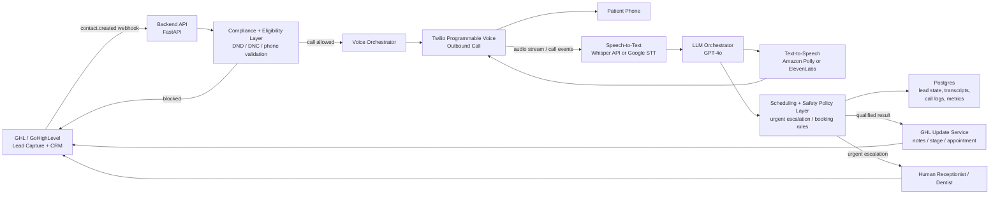
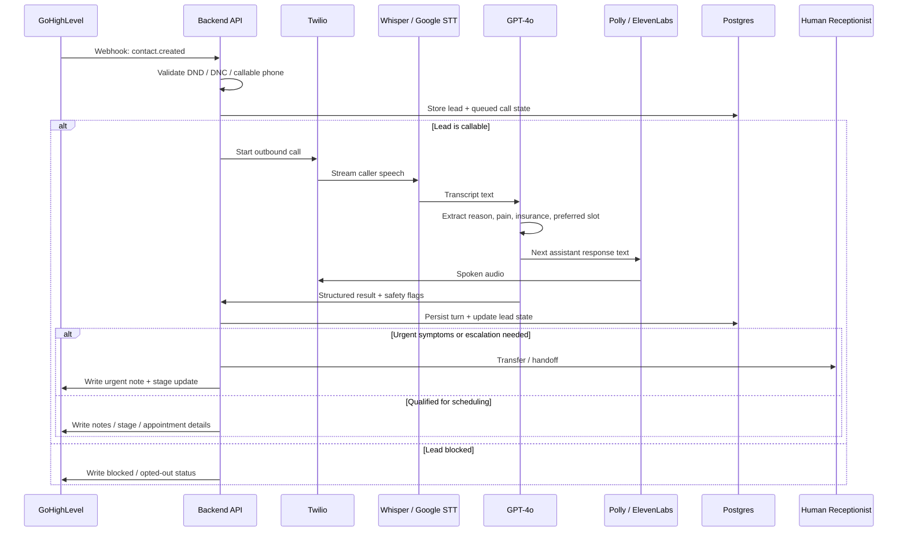

# Production Architecture Diagram

This diagram shows the intended full production workflow for the assignment, using the technologies suggested.

## High-Level Architecture

## Call Sequence

## Component Notes

- `GoHighLevel`: source of truth for inbound leads and final CRM updates.
- `Backend API (FastAPI)`: receives webhooks, enforces compliance, orchestrates the call, stores state, and writes back to GHL.
- `Twilio`: places the outbound call and handles the telephony session.
- `STT`: converts caller speech into text for the language model.
- `GPT-4o`: manages dialogue, structured extraction, and tool-calling style decisions.
- `TTS`: turns assistant responses into spoken audio for the live call.
- `Postgres`: stores lead records, call attempts, transcripts, structured outputs, and audit data.
- `Human handoff`: receives urgent or unsafe calls immediately when the AI should stop.

## Related Notes

- See [compliance.md](/home/josh/Desktop/Application/interview/compliance.md) for DND / DNC handling, PHI minimization, encryption expectations, and escalation rules.
