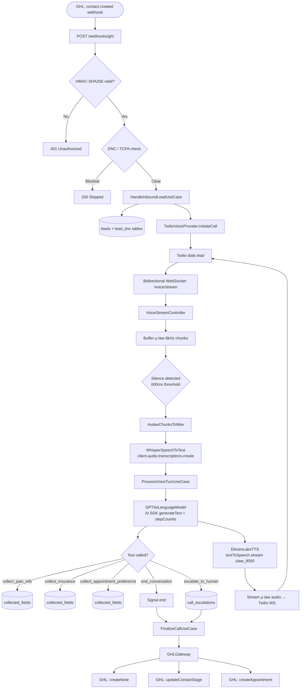

# System Architecture

## Flow Diagram



---

## Clean Architecture Layers

The codebase follows Clean Architecture (Robert C. Martin). The **dependency rule** is strictly enforced: arrows point inward only.

```
┌────────────────────────────────────────────────────────┐
│  Frameworks & Drivers                                  │
│  Express · Twilio SDK · OpenAI SDK · TypeORM · WS      │
│                                                        │
│  ┌──────────────────────────────────────────────────┐  │
│  │  Interface Adapters (infrastructure/)            │  │
│  │  Controllers · Repositories · Providers ·       │  │
│  │  Middleware                                      │  │
│  │                                                  │  │
│  │  ┌────────────────────────────────────────────┐  │  │
│  │  │  Application (application/)               │  │  │
│  │  │  Use Cases · Port Interfaces              │  │  │
│  │  │                                           │  │  │
│  │  │  ┌──────────────────────────────────────┐ │  │  │
│  │  │  │  Domain (domain/)                    │ │  │  │
│  │  │  │  Entities · Repository Interfaces    │ │  │  │
│  │  │  └──────────────────────────────────────┘ │  │  │
│  │  └────────────────────────────────────────────┘  │  │
│  └──────────────────────────────────────────────────┘  │
└────────────────────────────────────────────────────────┘
```

| Layer | Contents | Knows about |
|-------|----------|-------------|
| `domain/` | Lead, Call, Transcript, CollectedFields entities; repository interfaces | Nothing external |
| `application/` | HandleInboundLeadUseCase, ProcessVoiceTurnUseCase, FinalizeCallUseCase; port interfaces | Domain only |
| `infrastructure/` | TypeORM entities, repositories, Twilio/OpenAI/ElevenLabs/GHL adapters, Express controllers | Application + Domain |

---

## Component Descriptions

### POST `/webhooks/ghl`
Entry point for new GHL leads. Validates HMAC-SHA256 signature, runs DNC/TCPA checks, persists lead, and triggers an outbound Twilio call with a `<Connect><Stream>` TwiML instruction pointing to the WebSocket endpoint.

### WebSocket `/voice/stream`
Twilio Media Streams connects here. Handles the full real-time conversation loop:
1. Buffer incoming μ-law 8kHz audio chunks
2. Silence detection (600ms) → flush buffer → build WAV
3. Whisper STT → transcript text
4. GPT-4o `runTools()` with Fabric-structured dental qualifier prompt → reply + tool events
5. ElevenLabs TTS (`ulaw_8000`) → stream audio back to Twilio

### Conversation State
Managed in `VoiceStreamController` per WebSocket session. Maintains growing `conversationHistory` (passed to GPT-4o each turn) and `turnIndex` for ordered transcript storage.

### GHL Update
Triggered on call end via `FinalizeCallUseCase`:
- Creates a note with collected fields + outcome
- Updates `ai_call_stage` custom field
- Books appointment if `preferred_slot` was collected and call was not escalated

---

## Key Technical Choices

| Choice | Reason |
|--------|--------|
| `<Connect><Stream>` (bidirectional) | Enables real-time two-way audio vs. one-way `<Start><Stream>` |
| Vercel AI SDK `generateText` + `stepCountIs` | Provider-agnostic tool loop (swap OpenAI for Anthropic in one line); avoids proprietary `runTools()` lock-in |
| `ulaw_8000` ElevenLabs format | Twilio-native μ-law 8kHz — zero re-encoding, lower latency |
| `synchronize: false` TypeORM | Schema mutations only via versioned migrations |
| Separate ORM entities from domain | Domain stays pure; no framework decorators in business logic |
| `timingSafeEqual` for HMAC | Prevents timing-based signature forgery |
